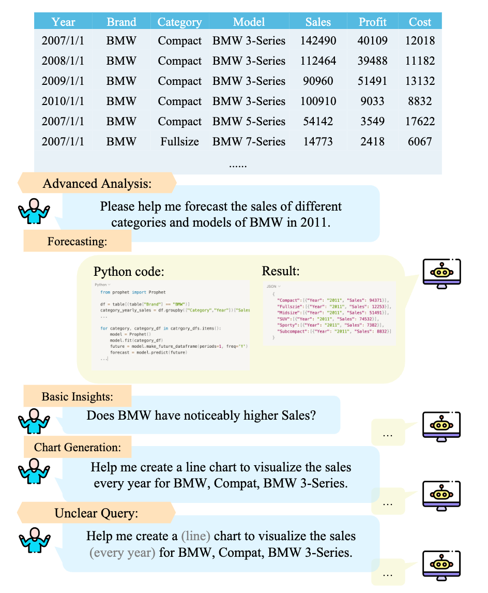
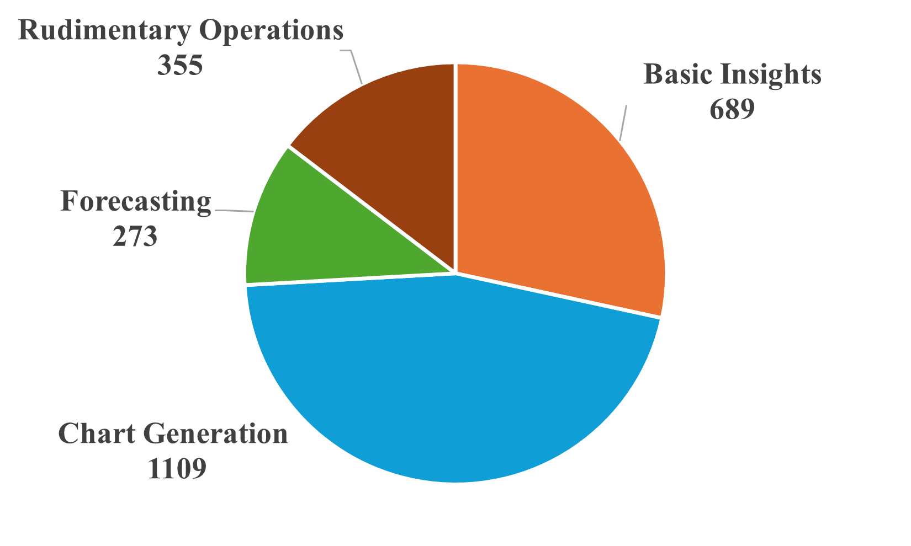
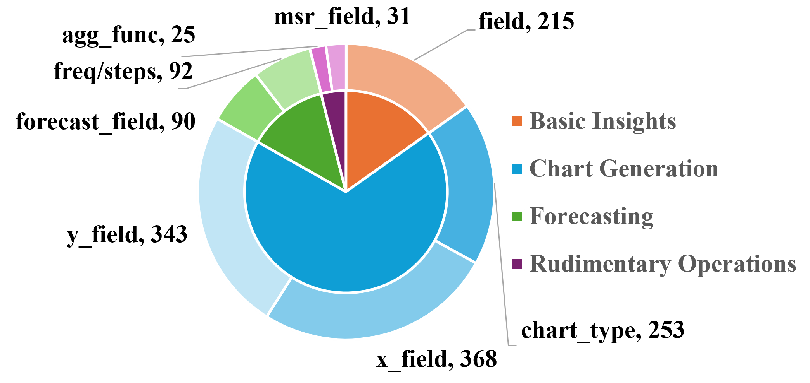

# Text2Analysis

This repo is the code and data for [_Text2Analysis: A Benchmark of Table Question Answering with Advanced Data Analysis and Unclear Queries_](https://arxiv.org/abs/2312.13671). Text2Analysis is a dataset including advanced analysis tasks and unclear queries that were rarely addressed in previous research work.


<center>Examples of Text2Analysis Benchmark.</center>

## Overall
Tabular data analysis is crucial in various fields, and large language models show promise in this area. However, current research mostly focuses on rudimentary tasks like Text2SQL and TableQA, neglecting advanced analysis like forecasting and chart generation. To address this gap, we developed the Text2Analysis benchmark, incorporating advanced analysis tasks that go beyond the SQL-compatible operations and require more in-depth analysis. We also develop five innovative and effective annotation methods, harnessing the capabilities of large language models to enhance data quality and quantity. Additionally, we include unclear queries that resemble real-world user questions to test how well models can understand and tackle such challenges. Finally, we collect 2249 query-result pairs with 347 tables. We evaluate five state-of-the-art models using three different metrics and the results show that our benchmark presents introduces considerable challenge  in the field of tabular data analysis, paving the way for more advanced research opportunities.

## Data Statistics and Distribution

Text2Analysis encompasses a total of 2249 $(table,\ query,\ code,\ result)$ pairs, sourced from 347 distinct tables. 
Queries of Text2Analysis encompass a variety of tasks. And they encompass a diversity of unclear queries. Those figures highlight the distribution of queries and code and further showcase the  diversity of the dataset and the difficulty of the problem.


<center>Analysis Task Distribution of All Queries. </center>


<center>Task & Parameter Distribution of Unclear Queries. </center>

## Details of Text2Analysis
The Text2Analysis dataset includes the following components:

+ table_name: The name of the table.
+ html: The HTML representation of the corresponding table.
+ query: The specific query related to the data.
+ operations: The operations involved in the query.
+ ambiguities: The ambiguities associated with the query.
+ python: The Python code that provides solution(s) to the query.
+ python_res: The result obtained from executing the Python code.
+ source: The origin or source of the data.
+ ori_query: The original form of the query.
+ given_parameter: The parameter related to the query's ambiguities.

The dataset will be publicly available after the company’s approval process is completed.

## How to run Text2Analysis
Please follow these steps:
+ Add your own inference model function run_llm() in [excel_api/run.py](api/run.py).
+ Run [run_inference.py](run_inference.py) with the following shell:
```shell
python run_inference.py --model <model_name> --output_dir <output_dir>
```

+ Evaluate with [run_test.py](run_test.py):
```shell
python run_test.py --model <model_name> --output_dir <output_dir>
```

## Citation
If you find our work helpful, please use the following citations.
```
@article{
    xinyihe2024text2analysis,
    title={Text2Analysis: A Benchmark of Table Question Answering with Advanced Data Analysis and Unclear Queries}, 
    volume={38}, 
    url={https://ojs.aaai.org/index.php/AAAI/article/view/29779}, 
    DOI={10.1609/aaai.v38i16.29779}, 
    number={16}, 
    journal={Proceedings of the AAAI Conference on Artificial Intelligence}, 
    author={He, Xinyi and Zhou, Mengyu and Xu, Xinrun and Ma, Xiaojun and Ding, Rui and Du, Lun and Gao, Yan and Jia, Ran and Chen, Xu and Han, Shi and Yuan, Zejian and Zhang, Dongmei}, 
    year={2024}, 
    month={Mar.}, 
    pages={18206-18215}
}
```

## Trademarks

This project may contain trademarks or logos for projects, products, or services. Authorized use of Microsoft 
trademarks or logos is subject to and must follow 
[Microsoft's Trademark & Brand Guidelines](https://www.microsoft.com/en-us/legal/intellectualproperty/trademarks/usage/general).
Use of Microsoft trademarks or logos in modified versions of this project must not cause confusion or imply Microsoft sponsorship.
Any use of third-party trademarks or logos are subject to those third-party's policies.